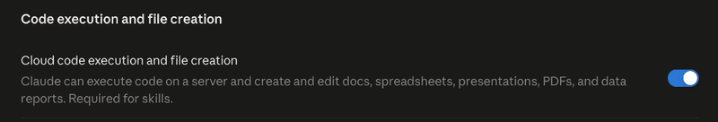
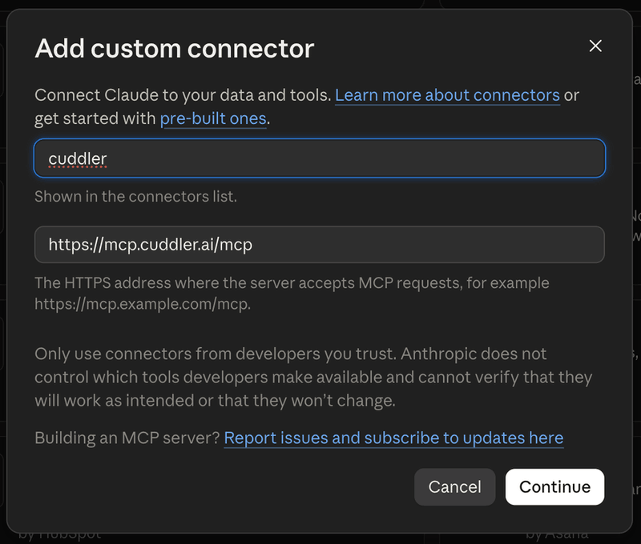
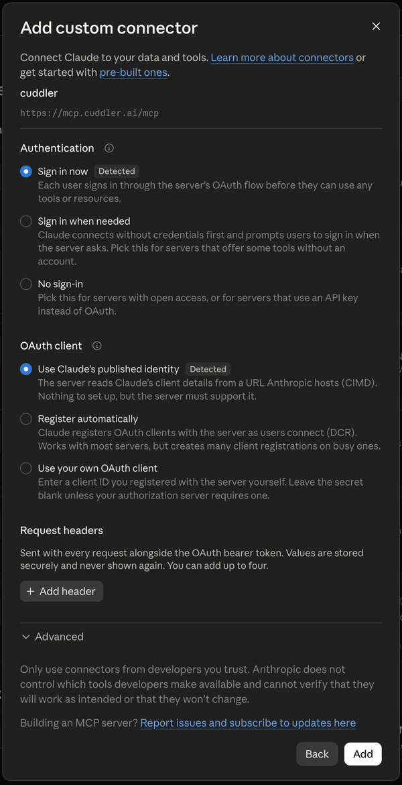
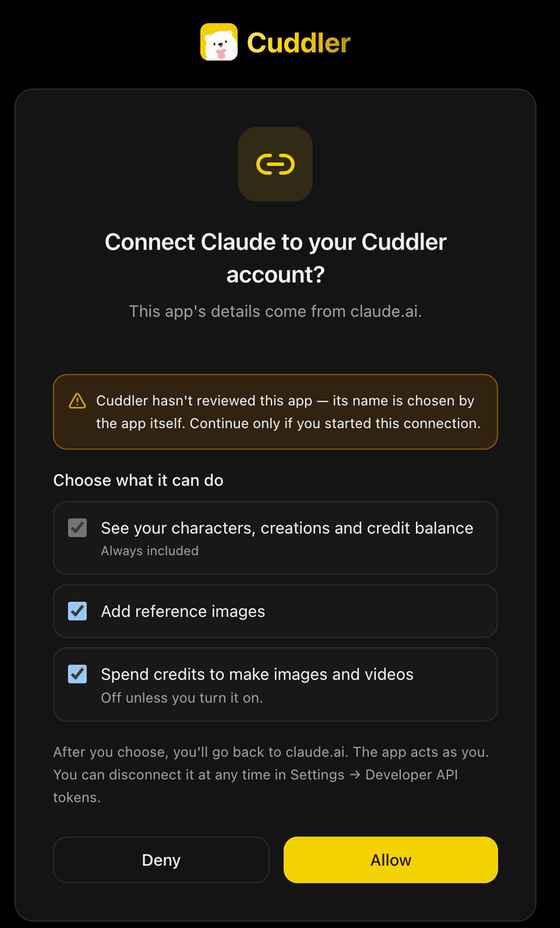
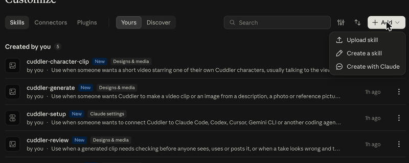
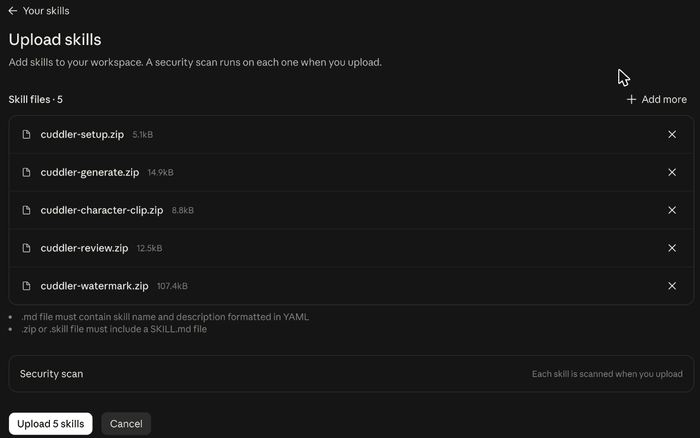

# Cuddler skills

<!-- claims:tagline -->
Make AI videos and images from Claude Code, Codex, Cursor or OpenClaw, with the Cuddler membership you already have.
<!-- /claims:tagline -->

<!-- claims:beta -->
**Beta.** The skills are new and still changing. Tell us what breaks in the issues.
<!-- /claims:beta -->

Skills and a plugin for coding agents and for OpenClaw. Install them, connect your Cuddler account once in the browser, and ask your agent for a video. It shows the price, waits for your OK, renders on Cuddler and saves the file next to your project; in OpenClaw it sends the file into your chat.

## What you can do

| Skill | Ask your agent |
|---|---|
| [`cuddler-setup`](skills/cuddler-setup/SKILL.md) | "Connect my Cuddler account" — install, sign in, see your plan, credits and what your account can make |
| [`cuddler-generate`](skills/cuddler-generate/SKILL.md) | "Make a 10-second vertical clip of a paper boat in the rain" — videos and images, priced before anything is spent |
| [`cuddler-character-clip`](skills/cuddler-character-clip/SKILL.md) | "Turn my character into a 15-second clip" — one of your own Cuddler characters talking to the viewer |
| [`cuddler-review`](skills/cuddler-review/SKILL.md) | "Review ./clip.mp4 before I post it" — a local ffmpeg check with a pass, fix or reject verdict |
| [`cuddler-watermark`](skills/cuddler-watermark/SKILL.md) | "Add the Cuddler watermark to ./my-cut.mp4" — the app's corner mark, stamped locally with ffmpeg |

## What you need

- A Cuddler account on a paid plan (Lite, Pro or Ultra), or in Cuddler's Creator Partnership Program. You sign in once in your browser, and the setup skill tells you what your plan can make.
- `curl`, which the skills use to save finished files; `ffmpeg` and `ffprobe` only for `cuddler-review` and `cuddler-watermark`.
- Room in your project: finished files go to `./out/` (character clips to `./cc/`, reviewed clips to `./clips/` and `<clip>.review/`). Add those folders to your `.gitignore` if the project is a repository.

## Install

### Claude Code

<!-- claims:install.claude_code -->
```bash
claude plugin install cuddler --marketplace CuddlerAI/skills
```
<!-- /claims:install.claude_code -->

Restart Claude Code, then type `/mcp`, choose the Cuddler server and sign in.

### Claude app

In the Claude app's chat (claude.ai and the desktop app), Cuddler is a connector plus five skills you upload. Until Cuddler is listed in Claude's directory, add them by hand:

1. **Turn on code execution**: Settings → Capabilities → **Code execution and file creation**. Skills need it.
2. **Add the connector**: Customize → Connectors → **+ Add** → **Add custom connector**. Name it `Cuddler`, set the URL to `https://mcp.cuddler.ai/mcp`, choose **Continue**, keep the detected sign-in options and choose **Add**. Then choose **Connect**, sign in to Cuddler in your browser, tick **Spend credits to make images and videos** and choose **Allow**.
3. **Download the five skills** from the latest release: [cuddler-setup](https://github.com/CuddlerAI/skills/releases/latest/download/cuddler-setup.zip), [cuddler-generate](https://github.com/CuddlerAI/skills/releases/latest/download/cuddler-generate.zip), [cuddler-character-clip](https://github.com/CuddlerAI/skills/releases/latest/download/cuddler-character-clip.zip), [cuddler-review](https://github.com/CuddlerAI/skills/releases/latest/download/cuddler-review.zip), [cuddler-watermark](https://github.com/CuddlerAI/skills/releases/latest/download/cuddler-watermark.zip).
4. **Upload them**: Customize → Skills → **+ Add** → **Upload skill**, select all five ZIPs and choose **Upload 5 skills**. Each skill is on as soon as it's added.

Then ask in a new chat: "Is my Cuddler account connected?"

<details>
<summary>Step by step, with screenshots</summary>

**1. Code execution.** Settings → Capabilities:



**2. The connector.** Customize → Connectors → + Add → Add custom connector:



Keep what Claude detects: **Sign in now** and **Use Claude's published identity**. No request headers are needed.



After **Connect**, the desktop app may first ask "Finish connecting a connector?": choose **Continue connecting**. Then Cuddler asks what Claude may do. Tick **Spend credits to make images and videos** if Claude should make things, and choose **Allow**:



**3 and 4. The skills.** Customize → Skills → + Add → Upload skill:



Select all five ZIPs at once:



</details>

### Codex

<!-- claims:install.codex -->
```bash
codex plugin marketplace add CuddlerAI/skills
codex plugin add cuddler@cuddler
codex mcp login cuddler
```
<!-- /claims:install.codex -->

In the Codex app: **Plugins → Add → Add a marketplace**, enter `CuddlerAI/skills`, then install Cuddler from the **Personal** tab. Step by step for the [Codex app](INSTALL.md#codex-app) and the [Codex CLI](INSTALL.md#codex-cli).

### OpenClaw

<!-- claims:install.openclaw -->
```bash
openclaw plugins install clawhub:cuddler
openclaw mcp add cuddler --url https://mcp.cuddler.ai/mcp --transport streamable-http --auth oauth --header X-Cuddler-Source=plugin --timeout 240
openclaw mcp login cuddler
```
<!-- /claims:install.openclaw -->

Cuddler is on ClawHub as [`cuddler`](https://clawhub.ai/cuddler/plugins/cuddler). The plugin brings the skills and the Cuddler MCP server; the other two commands sign you in. In the Control UI: **Plugins → Cuddler → Accounts → Connect** instead. Finished files come back in your chat. Step by step: [INSTALL.md](INSTALL.md#openclaw).

### Cursor, Gemini CLI and other agents

<!-- claims:install.other -->
```bash
npx skills add CuddlerAI/skills
```
<!-- /claims:install.other -->

Then add the Cuddler MCP server to your agent; the Cuddler assistants page below has one-click links. Step by step: [INSTALL.md](INSTALL.md). Or paste [INSTALL_FOR_AGENTS.md](INSTALL_FOR_AGENTS.md) to your agent and let it do the install.

## Updates

Each change to the skills ships as a new version, with its notes on the Releases page. The Cuddler MCP server updates on its own; the skills update like this:

- **Claude Code**: in `/plugin`, open the Cuddler marketplace and choose **Enable auto-update**. By hand: `/plugin marketplace update cuddler`.
- **Claude app**: download the five ZIPs again, upload them and choose **Replace** for each skill.
- **Codex**: **Upgrade marketplace** next to Cuddler in the app, or `codex plugin marketplace upgrade cuddler`.
- **OpenClaw**: `openclaw plugins update cuddler`.
- **Cursor, Gemini CLI and other agents**: `npx skills update`.

## Credits and limits

<!-- claims:credits -->
Renders spend credits from your own Cuddler account: the quote is the price. Your agent shows the price first and waits for your OK.
<!-- /claims:credits -->

<!-- claims:limits -->
Cuddler's server charges at most the quoted price for each render, and in agents that support it, it also asks you in the agent's own dialog before each paid call. There is no separate daily cap unless Cuddler sets one: your credit balance is the limit.
<!-- /claims:limits -->

<!-- claims:plans -->
Connecting needs a paid Cuddler plan (Lite, Pro or Ultra) or a place in Cuddler's Creator Partnership Program; free plans, trials and gifted plans can't connect. Videos need a plan that includes video. The setup skill tells you what your account can make.
<!-- /claims:plans -->

## Privacy and safety

- You sign in on cuddler.ai in your own browser. Your agent never sees your password, and you can disconnect it any time in Settings → Developer API tokens.
- Everything you make stays private in your Cuddler account until you publish it in the Cuddler app.
- The plugin adds one fixed header, `X-Cuddler-Source: plugin`, to its requests to the Cuddler MCP server, so Cuddler can count the connections that come from the plugin. It says nothing about you or your machine. The package for the ChatGPT and Codex plugin directory leaves it out, because the directory doesn't take request headers.
- The skills refuse content with minors, school settings, real people, and other people's characters or brands.
- Found a security problem? Report it privately: [SECURITY.md](SECURITY.md).

## Help

- A skill did something wrong, or a page here is unclear: open an issue here (the Issues tab) with your agent and its version, what you asked and what came back. Leave out tokens, approval links and screenshots of sign-in pages.
- Your account, plan, credits or a charge: [Cuddler support](https://cuddler.ai/support?utm_source=github&utm_medium=readme&utm_campaign=agent_skills); this repository can't see your account.
- A security problem: [SECURITY.md](SECURITY.md), privately.

## Links

<!-- claims:links -->
[Cuddler](https://cuddler.ai/?utm_source=github&utm_medium=readme&utm_campaign=agent_skills) · [Plans](https://cuddler.ai/membership?utm_source=github&utm_medium=readme&utm_campaign=agent_skills) · [Cuddler in ChatGPT, Claude and other assistants](https://cuddler.ai/mcp?utm_source=github&utm_medium=readme&utm_campaign=agent_skills)
<!-- /claims:links -->

## Contributing

See [CONTRIBUTING.md](CONTRIBUTING.md). Every skill shares the same hard rules, and `node scripts/validate.mjs` checks them on every pull request.

## License

The skills, scripts and manifests are MIT licensed ([LICENSE](LICENSE)). The Cuddler name and logo are trademarks of Cuddler and are not covered by the MIT license; [TRADEMARKS.md](TRADEMARKS.md) says what that means for forks.
